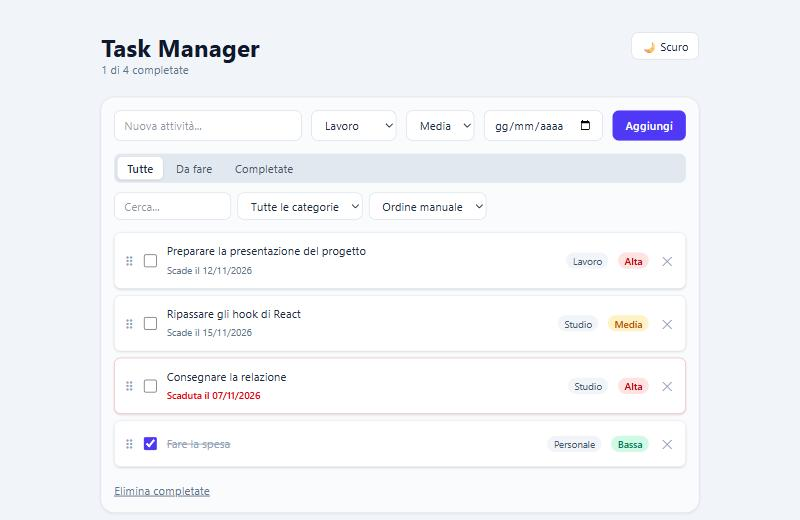

# Task Manager

Applicazione per gestire attività quotidiane, realizzata con **React** e **Tailwind CSS**.

**Demo online: https://adrianko112.github.io/react-manager/**



## Funzionalità

- Aggiunta, completamento, modifica (doppio click) ed eliminazione delle attività
- Categorie (Lavoro, Studio, Personale) e priorità (Bassa, Media, Alta)
- Filtri per stato e categoria, con ricerca testuale
- Scadenze con evidenziazione dei ritardi e ordinamento per data
- Riordino con drag & drop (anche da tastiera) tramite dnd-kit
- Tema chiaro/scuro, parte dalla preferenza di sistema e viene salvato
- Persistenza dei dati in `localStorage` tramite un custom hook
- Layout responsive e controlli accessibili (aria-label, focus ring)
- 24 test automatici con Vitest e React Testing Library

## Tecnologie

React 19 · Vite · Tailwind CSS 4 · dnd-kit · Vitest + Testing Library

## Concetti React usati

- `useState`, `useMemo`, `useEffect`
- Custom hook (`useLocalStorage`)
- Componenti riutilizzabili e props / callback
- Aggiornamenti di stato immutabili

## Avvio

```bash
npm install
npm run dev
```

## Test

```bash
npm test
```

## Build di produzione

```bash
npm run build
```

## Possibili miglioramenti

- Notifiche per le scadenze
- Backend con autenticazione e sincronizzazione tra dispositivi
- TypeScript
